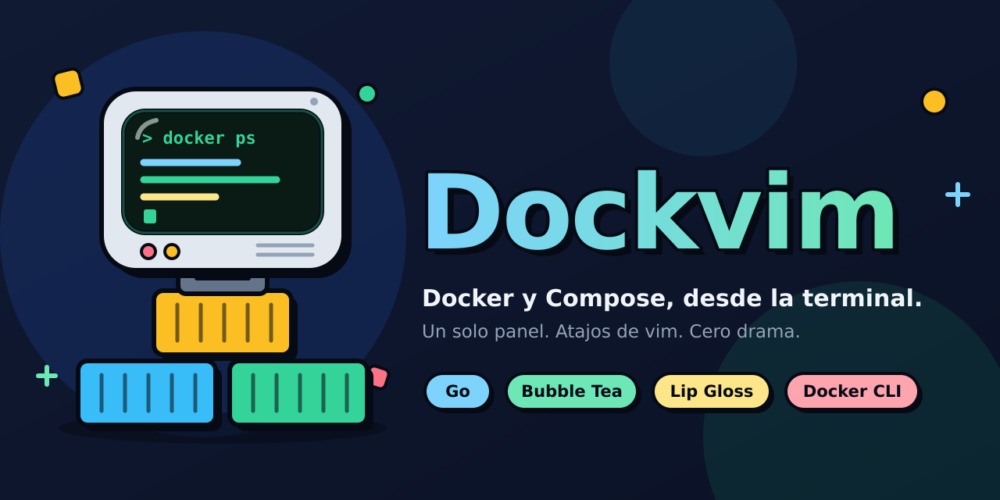

# Dockvim



TUI minimalista de panel único para administrar contenedores Docker y proyectos Docker Compose, escrita en Go con Bubble Tea y Lip Gloss. Usa la CLI `docker`, no el SDK.

## Requisitos

- Go 1.23 o superior
- Docker CLI instalado
- Acceso al daemon Docker (`docker ps` debe funcionar)
- Para acciones Compose: Docker Compose v2
- Terminal compatible con pantalla alternativa; se recomienda 100x30 o más

## Ejecutar

Descargar el binario precompilado desde [Releases](https://github.com/pablotrianda/dockvim/releases).

Compilar e instalar:

```bash
git clone https://github.com/pablotrianda/dockvim
cd dockvim
go mod tidy
go build -o dockvim ./cmd/dockvim
sudo install -m 0755 dockvim /usr/local/bin/dockvim
```

## Teclas

| Tecla | Acción |
|---|---|
| `j` / `k`, flechas | Navegar |
| `g` / `G` | Primer / último elemento |
| `Tab` | Alternar Contenedores / Compose |
| `/` | Buscar por nombre; `Enter` confirma, `Esc` cancela |
| `l` | Logs en vivo del contenedor seleccionado |
| `e` | Abrir `sh` interactivo en el contenedor |
| `s` | Iniciar contenedor |
| `x` | Detener contenedor (confirmación) |
| `r` | Reiniciar contenedor (confirmación) |
| `u` | `docker compose up -d` para el proyecto (confirmación) |
| `d` | `docker compose down` para el proyecto (confirmación) |
| `R` | Actualizar lista |
| `q` | Salir |

## Cómo detecta Compose

Los proyectos se agrupan usando la etiqueta `com.docker.compose.project`. Para `up` y `down`, dockvim lee además:

- `com.docker.compose.project.working_dir`
- `com.docker.compose.project.config_files`

Si esas etiquetas no están disponibles, la acción se cancela con un error explicativo. Para proyectos creados con versiones/configuraciones antiguas, recreados manualmente o gestionados por Portainer, puede que sea necesario ajustar la detección o agregar una configuración explícita de directorios Compose.

## Notas

- `docker logs -f` y `docker exec -it` se ejecutan como procesos interactivos y luego devuelven el control a la TUI.
- `docker compose down` elimina contenedores y redes del proyecto; por eso requiere confirmación.
- La lista se actualiza cada 5 segundos y también con `R`.
- La búsqueda filtra la lista actual, no hace una búsqueda en Docker.
- El programa no ejecuta comandos de shell construidos con nombres de contenedores; cada argumento se pasa por separado a `os/exec`.

## Limitaciones del MVP

- Los logs recientes se consultan con `L`; la interfaz mantiene el listado principal en un único panel.
- La shell interactiva usa `sh`; se puede cambiar a `bash` para imágenes que lo incluyan.
- Compose `up/down` depende de las etiquetas que Docker haya guardado en los contenedores.
- No incluye aún filtros por estado, configuración de tema, navegación por servicios individuales ni selección de múltiples contenedores.


### Presentación de puertos

La tabla muestra solo puertos publicados en el host en formato compacto `HOST→CONTENEDOR` (por ejemplo `8000→80`). Los puertos internos sin publicación se muestran como `—`. Las columnas se ajustan a terminales angostas y la ayuda se divide en dos líneas.
